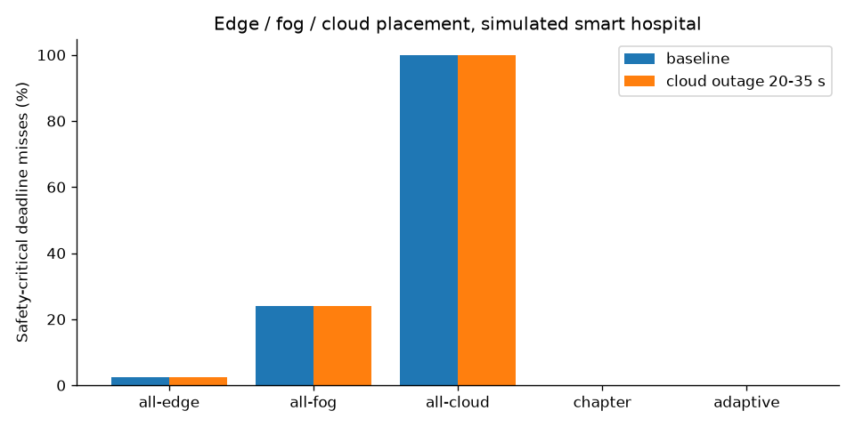

# Simulation results

> SIMULATION ONLY. All inputs are assumptions (docs/assumptions.md); results show what follows from those assumptions, not measurements of real hospital systems.

Generated by `edgefog report --duration 60 --seed 7`.

## 1. Table 9.1 re-examined (reference task, 8 KB in / 0.02 GFLOP)

| Characteristic | cloud (chapter → simulated) | edge (chapter → simulated) | fog (chapter → simulated) |
|---|---|---|---|
| Latency | high → p50 73.9 ms, p99 113.2 ms | low → p50 4.0 ms, p99 4.0 ms | medium → p50 4.9 ms, p99 7.4 ms |
| Processing location | centralised | local device | distributed (hospital) |
| Cost | high → $0.000370 / 1k tasks | low → $0.000004 / 1k tasks | medium → $0.000080 / 1k tasks |
| Security (proxy: raw data leaving the hospital) | moderate → 8.5 KB/task off-premises | high → 0.0 KB/task off-premises | very high → 0.0 KB/task off-premises |
| Availability (15 s link outage) | not in table → 23.9% deadline misses | not in table → 0.0% deadline misses | not in table → 23.4% deadline misses |

## 2. Placement policies, baseline

| Policy | Tasks | Miss rate (all) | Miss rate (safety-critical) | Safety-critical p99 ms | Cost USD | Off-premises MB |
|---|---:|---:|---:|---:|---:|---:|
| all-edge | 149,540 | 2.80% | 2.47% | 72 s | 41.35 | 0.1 |
| all-fog | 149,540 | 23.77% | 23.99% | 1,695.7 | 41.89 | 0.1 |
| all-cloud | 149,540 | 99.84% | 99.88% | 105 s | 104.03 | 2,498.9 |
| chapter | 149,540 | 0.02% | 0.02% | 40.0 | 103.47 | 329.0 |
| adaptive | 149,540 | 0.00% | 0.00% | 40.0 | 103.06 | 201.1 |

### Deadline-miss rate per application, baseline

| Application (section) | Deadline ms | Chapter tier | all-edge | all-fog | all-cloud | chapter | adaptive | adaptive placed on |
|---|---:|---|---:|---:|---:|---:|---:|---|
| AI chatbot / virtual doctor (9.3.1-1) | 5,000 | cloud | 97% | 0 | 95% | 0 | 0 | fog:602 |
| Cloud EMR history analysis (9.3.1-2) | 30,000 | cloud | 0 | 0 | 73% | 0 | 0 | fog:60 |
| Disease outbreak prediction (9.3.1-3) | 600,000 | cloud | 0 | 0 | 0 | 0 | 0 | cloud:1 |
| Genomic analysis for precision medicine (9.3.1-4) | 900,000 | cloud | 0 | 0 | 0 | 0 | 0 | cloud:2 |
| Diagnostic model (re)training (9.3-1) | 3,600,000 | cloud | 100% | 100% | 0 | 0 | 0 | cloud:1 |
| Remote patient monitoring (ECG/SpO2/BP anomaly) (9.4.1-1) **(safety)** | 1,000 | edge | 0 | 9% | 99% | 0 | 0 | edge:11999 |
| Real-time stroke / seizure detection (9.4.1-2) **(safety)** | 500 | edge | 0 | 14% | 99% | 0 | 0 | edge:6004 |
| Smart infusion pump dose control (9.4b) **(safety)** | 200 | edge | 0 | 18% | 100% | 0 | 0 | edge:2399 |
| AI prosthesis motion adaptation (9.4.1-3) **(safety)** | 20 | edge | 0 | 23% | 100% | 0 | 0 | edge:60003 |
| Real-time ICU early warning (9.5.1) **(safety)** | 2,000 | fog | 0 | 0 | 98% | 0 | 0 | fog:1798 |
| AI-assisted ER triage (9.5.1) | 3,000 | fog | 0 | 0 | 97% | 0 | 0 | fog:60 |
| 5G fog robotic-surgery vision assist (9.5.1) **(safety)** | 50 | fog | 100% | 20% | 100% | 0 | 0 | fog:3602 |
| AI haptic feedback for tele-surgery (9.5.1) **(safety)** | 10 | fog | 0 | 30% | 100% | 0% | 0 | edge:60007 |
| VR cognitive behavioural therapy (9.5.1) | 100 | fog | 0 | 19% | 100% | 0 | 0 | edge:3002 |

## 3. Placement policies, cloud link down from 20 s to 35 s

| Policy | Tasks | Miss rate (all) | Miss rate (safety-critical) | Safety-critical p99 ms | Cost USD | Off-premises MB |
|---|---:|---:|---:|---:|---:|---:|
| all-edge | 149,540 | 2.80% | 2.47% | 72 s | 41.35 | 0.1 |
| all-fog | 149,540 | 23.77% | 23.99% | 1,695.7 | 41.89 | 0.1 |
| all-cloud | 149,540 | 99.85% | 99.88% | 120 s | 104.03 | 2,498.9 |
| chapter | 149,540 | 0.10% | 0.02% | 40.0 | 103.47 | 329.0 |
| adaptive | 149,540 | 0.00% | 0.00% | 40.0 | 103.06 | 201.1 |

### Deadline-miss rate per application, cloud outage

| Application (section) | Deadline ms | Chapter tier | all-edge | all-fog | all-cloud | chapter | adaptive | adaptive placed on |
|---|---:|---|---:|---:|---:|---:|---:|---|
| AI chatbot / virtual doctor (9.3.1-1) | 5,000 | cloud | 97% | 0 | 95% | 20% | 0 | fog:602 |
| Cloud EMR history analysis (9.3.1-2) | 30,000 | cloud | 0 | 0 | 85% | 0 | 0 | fog:60 |
| Disease outbreak prediction (9.3.1-3) | 600,000 | cloud | 0 | 0 | 0 | 0 | 0 | cloud:1 |
| Genomic analysis for precision medicine (9.3.1-4) | 900,000 | cloud | 0 | 0 | 0 | 0 | 0 | cloud:2 |
| Diagnostic model (re)training (9.3-1) | 3,600,000 | cloud | 100% | 100% | 0 | 0 | 0 | cloud:1 |
| Remote patient monitoring (ECG/SpO2/BP anomaly) (9.4.1-1) **(safety)** | 1,000 | edge | 0 | 9% | 99% | 0 | 0 | edge:11999 |
| Real-time stroke / seizure detection (9.4.1-2) **(safety)** | 500 | edge | 0 | 14% | 99% | 0 | 0 | edge:6004 |
| Smart infusion pump dose control (9.4b) **(safety)** | 200 | edge | 0 | 18% | 100% | 0 | 0 | edge:2399 |
| AI prosthesis motion adaptation (9.4.1-3) **(safety)** | 20 | edge | 0 | 23% | 100% | 0 | 0 | edge:60003 |
| Real-time ICU early warning (9.5.1) **(safety)** | 2,000 | fog | 0 | 0 | 98% | 0 | 0 | fog:1798 |
| AI-assisted ER triage (9.5.1) | 3,000 | fog | 0 | 0 | 97% | 0 | 0 | fog:60 |
| 5G fog robotic-surgery vision assist (9.5.1) **(safety)** | 50 | fog | 100% | 20% | 100% | 0 | 0 | fog:3602 |
| AI haptic feedback for tele-surgery (9.5.1) **(safety)** | 10 | fog | 0 | 30% | 100% | 0% | 0 | edge:60007 |
| VR cognitive behavioural therapy (9.5.1) | 100 | fog | 0 | 19% | 100% | 0 | 0 | edge:3002 |

